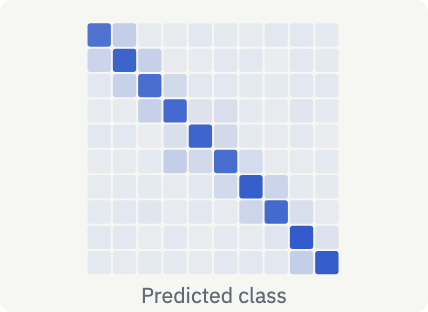
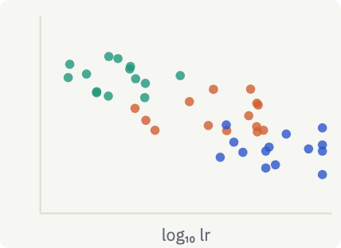

> An example page of pageview. The numbers are invented. Click **Source** (move the pointer on a block) to see the Markdown of each block.

## Summary

::: {.callout .result title="Result"}
AdamW gives the best test accuracy (94.1 %), and Lion is close (93.8 %). SGD is the fastest per epoch, but it is 2.9 points less accurate.
:::

::: stats
- 94.1 % | Best accuracy | AdamW
- 41.2 s | Fastest epoch | SGD
- 5 | Seeds per run | 0–4
- 6.1 GPU-h | Compute | 1 × A100
:::

## Results table

The table reads [runs.csv](runs.csv). Click a column name to sort it. The ★ marks the best value of each column.

::: {.table src="runs.csv" sd="acc:acc_sd loss:loss_sd" labels="optimizer: Optimizer | acc: Accuracy (%) | loss: Test loss | time: Epoch time (s) | notes: Notes" best="acc:max loss:min time:min" sort="acc:desc" dec="acc:1 loss:3 time:1"}
**Table 1.** Test results after 50 epochs. Each cell is mean ± standard deviation over 5 seeds.
:::

## Training curves

::: {.chart src="curves.csv" type="line" x="epoch" y="acc" color="optimizer" err="acc_sd" x-label="Epoch" y-label="Test accuracy (%)" y-min=60 y-max=96}
**Figure 1.** Test accuracy per epoch, mean ± sd of 5 seeds.
:::

## Figures

::: {.figures cols=3}




:::

## Settings

:::: tabs
::: {.tab title="AdamW"}
- lr: 1·10⁻³, warm-up 5 epochs, cosine decay
- β: (0.9, 0.999), weight decay 0.05
:::
::: {.tab title="Lion"}
- lr: 1·10⁻⁴, warm-up 5 epochs, cosine decay
- β: (0.9, 0.99), weight decay 0.5
:::
::: {.tab title="SGD"}
- lr: 0.1, step decay × 0.1 at epochs 25 and 40
- no momentum, weight decay 5·10⁻⁴
:::
::::

::: {.toggle title="Hardware and run details"}
| Item | Value |
|---|---|
| 🖥️ GPU | 1 × A100 40 GB |
| 🔢 Precision | bf16 |
| 🎲 Seeds | 0, 1, 2, 3, 4 |
| ⏳ Wall time | ≈ 6.1 h (± 0.2 h) |
| 🚦 Status | ✅ done · ⚠️ Adam seed 3 diverged · 🔁 Lion rerun planned |
:::

## Notes and method

:::: columns
::: {.col title="👍 What worked"}
- Weight decay applied apart from the gradient (AdamW)
- A warm-up of 5 epochs for all adaptive methods
:::
::: {.col title="👎 What did not"}
- Adam with lr ≥ 3·10⁻³ diverged (1 of 5 seeds)
- Batch 512 lost ≈ 0.4 points for all
:::
::::

The AdamW step applies the weight decay $\lambda$ apart from the adaptive term:

$$
\theta_{t+1} = \theta_t - \eta\left(\frac{\hat m_t}{\sqrt{\hat v_t}+\epsilon} + \lambda\,\theta_t\right)
$$

A plain Markdown table also gets sort and Copy:

| Optimizer | Peak memory (GB) | Steps / s |
|---|--:|--:|
| SGD | 3.1 | 412 |
| AdamW | 3.9 | 371 |
| Lion | 3.4 | 398 |

```bash
for opt in sgd sgdm nesterov adam adamw lion; do
  python train.py --opt "$opt" --epochs 50 --seeds 0-4 --out runs.csv
done
```

```{.widget title="Learning rate schedule" height=170}
<label style="font-size:13px">Warm-up epochs <input id="w" type="range" min="0" max="15" value="5"> <b id="v">5</b></label>
<svg id="s" viewBox="0 0 600 110" style="width:100%;display:block"></svg>
<script>
const w = document.getElementById('w'), s = document.getElementById('s');
function draw() {
  const k = +w.value; document.getElementById('v').textContent = k;
  const lr = e => e < k ? (e + 1) / (k + 1) : 0.5 * (1 + Math.cos(Math.PI * (e - k) / Math.max(1, 50 - k)));
  let d = ''; for (let e = 0; e <= 50; e += 0.5) d += (e ? 'L' : 'M') + (10 + e * 11.6) + ' ' + (100 - 90 * lr(e));
  s.innerHTML = `<path d="${d}" fill="none" stroke="var(--accent)" stroke-width="2"/>`;
}
w.oninput = draw; draw();
</script>
```

See also the grid of [ten models on ten datasets](../vision_grid.csv).
